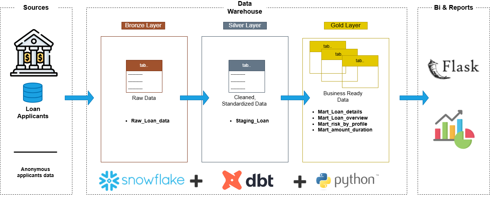
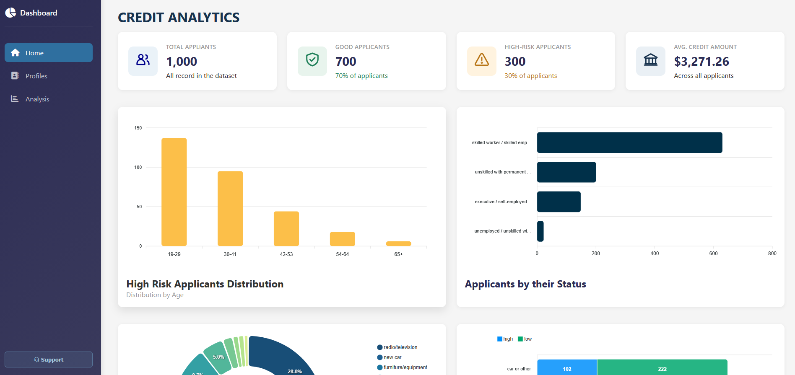

# Credit Analysis 

An end-to-end data analytics project built with Snowflake, Python, SQL, Pandas, Scikit-learn, and Flask to analyze credit risk and segment loan applicants based on their financial and demographic characteristics. The project uses data transformation, exploratory data analysis, and K-Means clustering to identify applicant profiles, evaluate observed credit-risk patterns, and present actionable insights through an interactive dashboard.



## 📝 Project Overview

An interactive Flask dashboard presents key performance indicators, credit-risk analysis, customer segmentation summaries, and visualizations covering loan amounts, loan durations, applicant demographics, and high-risk rates.

As a data engineer, I designed the project to bring together the main stages of an analytics workflow:

1. **Data** — Anonymous applicants data stored in `Snowflake Database`
2. **Transformation and modeling** — the `credit_dbt/` directory contains the dbt project.
3. **Application** — `app.py` provides the Flask application entry point.
4. **Dashboard assets** — the `main/` directory contains dashboard-related project files.


## 🧩 Project Goals

- Analyze the distribution of credit risk among loan applicants.
- Explore relationships between applicant characteristics and observed credit-risk categories.
- Segment applicants into five groups using K-Means clustering.
- Compare cluster profiles using financial, demographic, and credit-history indicators.
- Present analytical findings through an interactive dashboard.

## 📂 Repository Structure

```text
.
├── app.py              # Flask application entry point
├── requirements.txt    # Python dependencies
├── main/              # Dashboard-related files
├── data/               # Requesting data from Snowflake database
└── credit_dbt/        # dbt project
```

## 📊 Credit Analytics Dashboard



- **Live Demo:** [Credit Analytics Dashboard](https://credit-analysis-app-4qbe.onrender.com/)
- **Technologies:** DataWarehouse, Python, Flask, SQL, dbt, Snowflake, Machine Learning, JavaScript, ApexCharts, HTML, CSS
- **Features:** Credit Risk Analysis, Applicants segmentation, Profiles visualization, and End-to-End Analytics

### Run Locally

1. Clone this repository.
2. Install the required dependencies.
3. Configure your Snowflake Account Connexion.
4. Start the Flask application.
5. Open `http://127.0.0.1:5000` in your browser.